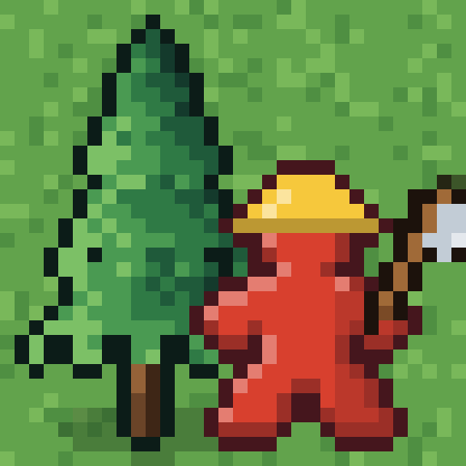
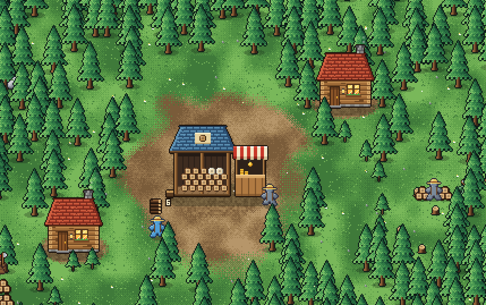

# MeepleJacks

**[▶ Play in your browser](https://octopushaberdashery.github.io/MeepleJacks/)** (installs to an iPhone or iPad home screen) · **[⬇ Android APK](https://github.com/OctopusHaberdashery/MeepleJacks/releases/latest/download/MeepleJacks.apk)** · [All releases](https://github.com/OctopusHaberdashery/MeepleJacks/releases)



A cozy pixel-art logging camp for Android tablets, in the spirit of
[Meeple Meadows](https://github.com/OctopusHaberdashery/meeple-meadows).



You start with a rusty hatchet and a Lumber Yard in the middle of a big forest.

- **Chop your own tree.** Tap a pine and your Meeple walks over, fells it and carries the logs to the yard.
  A tree gives one to three logs, more for the far-out kinds.
- **Sell the wood**, but hold some back: buildings and axes cost goods as well as coins.
- **Hire a crew.** Lumberjacks cut the nearest trees to their cabin, however far that takes them, and haulers
  carry the log piles in. A cabin can be set to one kind of wood, and any building can be moved for free.
- **Push outward.** The forest grows in rings around the yard, with a river running all the way round between
  each ring and the next. Each ring is tougher to cut, needs a better axe, and sells for more:

  | Tree | From the yard | Chops (matching axe) | Coins a log |
  |---|---|---|---|
  | Pine | all around it | 4 | 2 |
  | Birch | ~21 tiles | 5 | 5 |
  | Oak | ~35 tiles | 6 | 12 |
  | Maple | ~49 tiles | 7 | 28 |
  | Cherry | ~62 tiles | 8 | 65 |
  | Redwood | ~74 tiles | 9 | 150 |
  | Ebony | ~85 tiles | 11 | 340 |

- **Fell the Ancient trees.** One giant stands in every ring (the Map marks them in gold). It is far too much
  tree for one axe, so tap it and call your lumberjacks: up to twelve leave their own trees to help. When it comes
  down it leaves a great heap of logs and a hat, and the next river can be bridged.
- **Bridge the rivers.** A bridge is the only way over a river, and the first one over each river has to wait for
  that ring's Ancient tree. It can go anywhere along the bank, and extra bridges save the crew long walks. Move a
  cabin across so its lumberjacks are close to the new wood.
- **Work the wood.** Later buildings bring new kinds of Meeple:

  | Building | Meeple | What they do |
  |---|---|---|
  | Forester's Hut | Forester | replants stumps so trees come back sooner |
  | Sawmill | Sawyer | saws logs into planks worth 2.4 times as much |
  | Charcoal Kiln | Collier | burns three cheap logs into a sack of charcoal |
  | Log Depot | Carter | a drop-off in the woods; carters wheel big loads home |
  | Carpenter's Workshop | Carpenter | turns two planks into furniture (stools up to pianos) |
  | The Great Lodge | Builder | carries every piece from the yard to the site and fits it |

  A cabin can also take a **foreman**, who makes its crew 30% faster.
- **Meeples with quirks.** Everyone you hire has one: Strong Back, Quick Feet, Mighty Swing, Hat Magnet, Green
  Thumb, Nimble Fingers, Early Riser, Daydreamer, Snow Lover or Sun Chaser. Some only help in the right job, so a
  Meeple can be moved to any building with a free place (**Job** in the crew list). They also get better with time
  on the job, from Greenhorn up to Master, 6% faster at everything with each step.
- **Seasons.** The year turns every twenty minutes, five to a season, and the whole forest changes with it:

  | Season | What it does |
  |---|---|
  | Spring | trees grow back 50% faster |
  | Summer | sawyers, colliers and carpenters work 20% faster |
  | Autumn | orders pay 25% more, and hats shake loose twice as often |
  | Winter | haulers and carters sled 25% faster, but trees grow back 40% slower |

  Each season also has a fair of its own that sends extra orders for one kind of goods at a better price.
- **The Great Lodge** is the long project: seven storeys, one per wood, each raised in three steps and each with a
  lasting reward. Finishing it is the end of the game (about 15 hours for a tireless autoplayer; a person will take
  a good deal longer).
- **Orders** from the neighbours pay well over the usual price, and each one filled raises your standing with them.
- **Hats and silly walks.** Felling trees sometimes shakes a hat loose (25 to find: three per kind of tree, and
  one that only turns up in each season). Wear
  them, dress the crew, and choose how your Meeple gets about: waddle, moonwalk, cartwheel, backflips...
- Pinch to zoom from close-up pixels all the way out to the whole 192 × 192 forest.
- Goals that walk you through it, a map, three save slots, generated music, forest ambience, sound effects and a
  settings menu.

The camp only works while the game is open on screen. There is no offline progress.

## Install on your tablet

1. Copy `MeepleJacks.apk` to the tablet (USB, Google Drive, email to yourself, etc.).
2. Open it from the tablet's Files app.
3. If Android asks, allow your Files app to "Install unknown apps", then tap **Install**.

Updates install over the old version and keep your saves.

## Install on an iPhone or iPad

1. Open **https://octopushaberdashery.github.io/MeepleJacks/** in Safari.
2. Tap **Share**, then **Add to Home Screen**.
3. Open MeepleJacks from the home screen. It runs full screen and works without a connection.

Saves stay on the device you play on; the phone and the tablet each keep their own camps. When a new version is
published, opening the game while online picks it up.

## Layout

- `web/`: the game itself (HTML5 canvas, plain JavaScript, no dependencies)
  - `js/data.js`: trees, goods, axes, upgrades, buildings, crew, the Lodge, standing, hats and goals. Tune the game here.
  - `js/art.js`: all pixel art, drawn in code at load (trees, Meeples, hats, buildings, icons)
  - `js/world.js`: forest and river generation, you and every kind of crew, pathfinding, Ancient trees, bridges,
    seasons, orders, the Lodge, saving
  - `js/render.js`: renderer. Up close it draws one canvas pixel per art pixel and lets the browser scale it up
    crisply; zoomed far out it draws the forest from cached half- and quarter-size layers.
  - `js/ui.js`, `js/audio.js`, `js/main.js`
  - `dev/bot.js`: an autoplayer for measuring how long the game takes. Not included in the APK.
- `android/`: WebView wrapper (`MainActivity.java`), manifest, icons, `build.sh`
- `pwa/`: the installable web app: manifest, icons, service worker, `build.py` and `publish.sh`

## Building

No Gradle. `android/build.sh` runs aapt2 → javac → d8 → zipalign → apksigner from a plain JDK plus the Android
build-tools and platform jar, and inlines every script into one page (`android/bundle.py`) because some WebViews
refuse to load separate local files.

```bash
VERSION_CODE=3 VERSION_NAME=1.2 bash android/build.sh
```

The signing keystore and its password (`android/signing.env`) are git-ignored and must be kept to ship updates.

The web app is the same single page plus a manifest and a service worker. `bash pwa/publish.sh` builds it and
replaces the `gh-pages` branch, which GitHub Pages serves.

To play in a desktop browser, serve `web/` with any static server (add `?dev=4` to run time four times faster).
To time a full playthrough, open the title screen, load `dev/bot.js` and run `runBot()` in the console.
